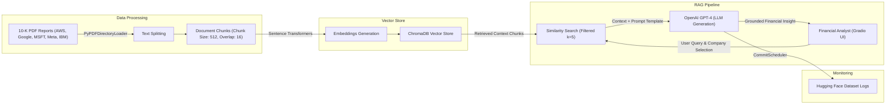

# RAG for Effective Information Retrieval (10-K Report Analysis)

An advanced Retrieval-Augmented Generation (RAG) system built to automate the extraction, summarization, and analysis of annual 10-K reports for major cloud and AI service providers.

---

## 🏢 Business Use Case & Problem Statement

* **Company Background:** Finsights Grey Inc. is a financial technology firm specializing in advanced analytics and insights for investment management and financial planning.
* **The Challenge:** Analysts manage extensive collections of 10-K reports detailing financial performance, risk factors, market trends, and strategic initiatives. Extracting precise information manually is time-consuming and creates a bottleneck for delivering timely client recommendations.
* **The Solution:** Implementation of an automated RAG-based system to drastically enhance the speed and accuracy of investment insights across five major platforms: **Amazon AWS, Google Cloud, Microsoft Azure, Meta AI, and IBM Watson**[cite: 1, 12].

---

## 🚀 Project Objectives

* **Automated Information Extraction:** Streamline the analysis of key 10-K report metrics[cite: 1].
* **Comparative Platform Research:** Evaluate major tech giants on AI acquisitions, R&D capital allocation, ethical AI initiatives, and competitive differentiation[cite: 1].
* **Productivity Enhancement:** Empower financial analysts with a rapid query tool for timely client recommendations[cite: 1].
* **Cloud Deployment:** Deploy an interactive web application on Hugging Face Spaces with automated evaluation and request logging[cite: 1, 14, 16].

---

## 📊 Architecture Overview


---
## 🛠️ Tech Stack Dependencies 
* **Language:** Python 
* **Frameworks:** LangChain, LangChain Community
* **Vector Database:** ChromaDB
* **Embeddings Model:** Hugging Face Sentence Transformers (thenlper/gte-large)   
* **Large Language Model:** OpenAI GPT-4 (used for response generation and LLM-as-a-judge evaluation)   
* **PDF Processing:** PyPDF / PyPDFDirectoryLoader   
* **Interface & Logging:** Gradio, Hugging Face Hub (CommitScheduler)   

## ⚙️ Installation & Local Setup

To run this project locally or within a notebook environment, install the required packages:

```bash
pip install openai==1.23.2 tiktoken==0.6.0 pypdf==4.0.1 langchain==0.1.1 langchain-community==0.0.13 chromadb==0.4.22 sentence-transformers==2.3.1
```

## 🎬 Project Pipeline & Workflow

1. **Data Preparation & Chunking:**
   * Loaded 2023 10-K PDF reports for AWS, Google, IBM, Meta, and Microsoft.
   * Split documents using `RecursiveCharacterTextSplitter.from_tiktoken_encoder` with a `chunk_size` of 512 and `chunk_overlap` of 16 using `cl100k_base` encoding.
2. **Vector Database Creation:**
   * Generated dense embeddings using the `thenlper/gte-large` model.
   * Stored document chunks in a persistent Chroma vector collection named `cloud_providers_annual_reports_2023`.
3. **Retrieval-Augmented Generation (RAG):**
   * Performed metadata-filtered similarity searches (`k=5`) targeting specific company filings.
   * Passed retrieved contexts and page references into custom system and user prompt templates.
   * Queried OpenAI GPT-4 with a temperature of `0` to synthesize precise answers.
4. **LLM Evaluation Framework:**
   * Assessed generation quality using an automated LLM rater (`gpt-4`) scored on a scale of 1 to 5:
     * **Groundedness:** Evaluates whether answers are derived strictly from the provided context without hallucinations.
     * **Relevance:** Measures how effectively the answer addresses the core aspects of the user query.
5. **Web Application & Logging:**
   * Developed an interactive Gradio interface allowing users to select a company and input financial queries.
   * Integrated `CommitScheduler` to log user inputs, retrieved contexts, and model outputs directly to a Hugging Face dataset.

---

## 🌐 Live Application & Datasets

* **Hugging Face Space App:** [Nyanzi Reports QnA Space](https://huggingface.co/spaces/jnyanzi/nyanzi_reports_qna)
* **Logs Dataset:** [Nyanzi Reports QnA Logs Dataset](https://huggingface.co/datasets/jnyanzi/logs_nyanzi_reports_qna)

---

## 📂 Repository Folder Structure

```Plaintext
rag-analyzer/
├── dataset/                # Initial 10-K PDF reports
│   ├── aws-10-k-2023.pdf
│   ├── google-10-k-2023.pdf
│   ├── IBM-10-k-2023.pdf
│   ├── Meta-10-k-2023.pdf
│   └── msft-10-k-2023.pdf
├── notebooks/              # Development notebooks and exports
│   ├── financial_rag_analysis.ipynb
│   └── financial_rag_analysis.html
├── cloud_db/               # Persisted Chroma vector database files
├── logs/                   # Log files generated by CommitScheduler
├── app.py                  # Main Gradio application script
├── requirements.txt        # Python package dependencies
├── README.md               # Project documentation & architecture
└── .gitignore              # Files to ignore (venv/, __pycache__, etc.)

```
