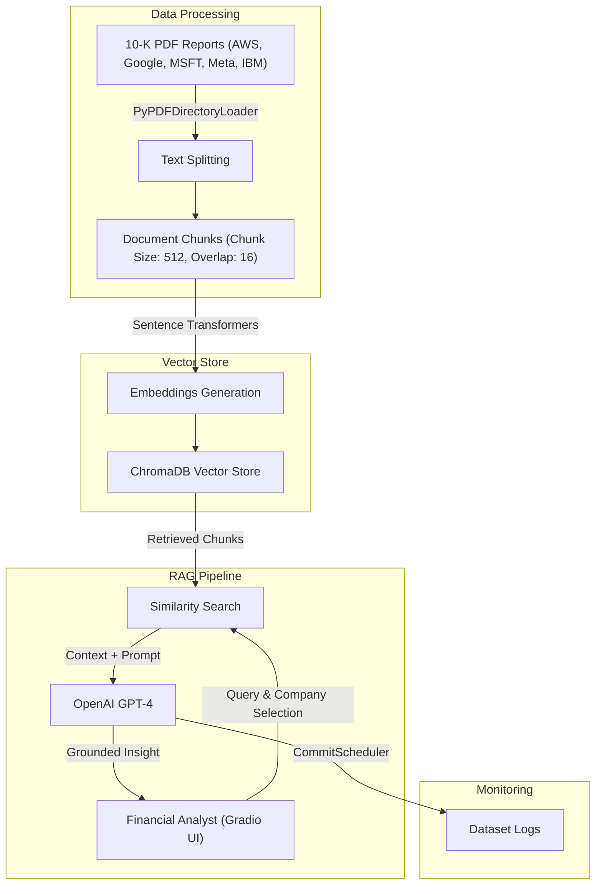

# Finsights Grey - RAG for Effective Information Retrieval (10-K Report Analysis)

An advanced Retrieval-Augmented Generation (RAG) system built to automate the extraction, summarization, and analysis of annual 10-K reports for major cloud and AI service providers.

---

## 🏢 Business Use Case & Problem Statement

* **Company Background:** Finsights Grey Inc. is a financial technology firm specializing in advanced analytics and insights for investment management and financial planning.
* **The Challenge:** Analysts manage extensive collections of 10-K reports detailing financial performance, risk factors, market trends, and strategic initiatives. Extracting precise information manually is time-consuming and creates a bottleneck for delivering timely client recommendations.
* **The Solution:** Implementation of an automated RAG-based system to drastically enhance the speed and accuracy of investment insights across five major platforms: **Amazon AWS, Google Cloud, Microsoft Azure, Meta AI, and IBM Watson**[cite: 1, 12].

---

## 🚀 Project Objectives

* **Automated Information Extraction:** Streamline the analysis of key 10-K report metrics[cite: 1].
* **Comparative Platform Research:** Evaluate major tech giants on AI acquisitions, R&D capital allocation, ethical AI initiatives, and competitive differentiation[cite: 1].
* **Productivity Enhancement:** Empower financial analysts with a rapid query tool for timely client recommendations[cite: 1].
* **Cloud Deployment:** Deploy an interactive web application on Hugging Face Spaces with automated evaluation and request logging[cite: 1, 14, 16].

---

## 📊 Architecture Overview

